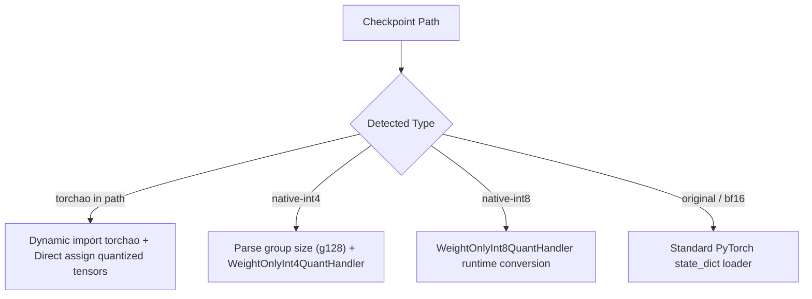

# Fish Speech S2-Pro: Quantization & Memory Optimization Guide

This document provides a comprehensive technical overview of the quantization pipelines, memory optimizations, and codebase fixes implemented for **Fish Speech S2-Pro** (`DualARTransformer` + `modded_dac` codec) to run efficiently on 16 GB GPUs (such as the NVIDIA GeForce RTX 5070 Ti).

---

## 1. Executive Summary & Problem Context

### The Challenge
- **Target Hardware**: NVIDIA GeForce RTX 5070 Ti (16,303 MiB physical VRAM).
- **Architecture**: Fish Speech S2-Pro combines:
  1. An autoregressive **Dual-AR Transformer** (~4 Billion parameters: 36-layer main text-audio transformer + 4-layer fast codebook transformer).
  2. A **Discrete Audio Codec (DAC)** neural vocoder for high-fidelity audio synthesis.
- **Initial Baseline Memory**:
  - Model weights alone in BF16: **~9.12 GB**
  - Uncapped KV-Cache (32,768 tokens): **~4.83 GB**
  - Unoptimized DAC Vocoder static attention masks: **~4.91 GB**
  - **Total Startup Requirement**: **> 18.8 GB VRAM** (Immediate Out of Memory on a 16 GB GPU).

### The Outcome
Through quantization, KV-cache right-sizing, vocoder buffer patching, and PyTorch Dynamo compiler compatibility fixes:
- **Baseline VRAM** was reduced from **> 18.8 GB to ~5.31 GB** (PyTorch Native INT4) or **~7.89 GB** (TorchAO FP8 compiled).
- **Generation Speed**: **~45–50 tokens/sec** using `fp8 --compile`.
- **Headroom**: Over **8–10 GB of free VRAM** remains available, preventing CUDA allocator fragmentation and out-of-memory crashes across repeated inference calls.

---

## 2. Quantization Tools: Architecture & Implementation

Two complementary quantization pipelines were developed/adapted to cater to different operational goals.

### 2.1. Adjustments to the Original Tool (`tools/llama/quantize.py`)

The repository included a legacy `quantize.py` originally designed for simple LLaMA architectures. Several modifications were required to make it compatible with the Fish Speech S2 Dual-AR architecture:

1. **Dual-AR Layer Support**:
   - `DualARTransformer` consists of both standard slow transformer layers (`layers.0` to `layers.35`) and fast transformer layers (`fast_layers.0` to `fast_layers.3`).
   - `WeightOnlyInt4QuantHandler` and `WeightOnlyInt8QuantHandler` were updated to traverse and quantize linear projections in both layer hierarchies (`wqkv`, `wo`, `w1`, `w2`, `w3`, `fast_layers`).
2. **Sensitive Weight Preservation**:
   - Audio embedding projectors, normalization layers (`norm`, `fast_norm`), and vocabulary embeddings (`embeddings`, `codebook_embeddings`, `fast_embeddings`) are preserved in full precision (`float16`/`bfloat16`) to maintain acoustic synthesis quality and avoid phonetic degradation.
3. **Dynamic Group Size & Checkpoint Naming**:
   - Configured groupwise INT4 quantization (`groupsize=128`).
   - The quantizer automatically encodes the group size into the directory path (e.g., `checkpoints/s2-pro-native-int4-g128`), which is parsed dynamically at runtime.
4. **Configuration & Semantic Token ID Injection**:
   - Automatically injects `semantic_begin_id` (151678) and `semantic_end_id` (155773) into the exported `config.json` so downstream loaders correctly initialize semantic range masks without external metadata dependencies.

### 2.2. The New TorchAO Quantizer (`tools/llama/quantize_torchao.py`)

To leverage modern GPU tensor core capabilities (specifically native FP8 support on Ada Lovelace and Blackwell RTX 50-series), a dedicated quantization tool was built using PyTorch's official **TorchAO** library.

- **Supported Formats**:
  - `fp8` (`float8_weight_only`): Preserves full dynamic range, executes on native FP8 tensor cores, and is fully compatible with `torch.compile(..., backend="inductor")`.
  - `int4` (`int4_weight_only`, `group_size=128`): High-compression groupwise integer quantization using PyTorch tensor subclasses.
  - `int8` (`int8_weight_only`): Balanced integer quantization.
- **Selective Quantization Filter**:
  ```python
  def filter_fn(module: nn.Module, fqn: str) -> bool:
      # Keep embeddings, normalizations, and projectors in full precision
      if any(k in fqn for k in ["embeddings", "norm", "audio_projector", "output"]):
          return False
      return isinstance(module, nn.Linear)
  ```
- **Serialization Handling**:
  - Employs `torch.save` with custom pickling to serialize TorchAO tensor subclasses (`AffineQuantizedTensor`) correctly, ensuring instant deserialization without rebuilding quantization graphs on launch.

---

## 3. Runtime Model Loader (`fish_speech/models/text2semantic/llama.py`)

To allow transparent loading of any quantization variant from a unified interface, `BaseTransformer.from_pretrained()` was overhauled:



1. **TorchAO Auto-Detection**:
   - When loading checkpoints containing `torchao` in their name, the loader dynamically imports `torchao` and directly assigns quantized tensor subclasses.
   - For INT4 TorchAO weights, weights are loaded to `cuda:0` directly during deserialization to bypass CPU-GPU tensor subclass registration bottlenecks.
2. **PyTorch Native Quantization Wrappers**:
   - For `native-int4` and `native-int8`, the model structure is instantiated, and linear layers are wrapped in runtime dequantization modules (`WeightOnlyInt4Linear`, etc.) before state dict ingestion.
3. **Robust SafeTensors / PyTorch Fallback**:
   - Checks for `model.safetensors`, falls back to `consolidated.00.pth` or `model.pth`, and remaps legacy Qwen3 Omni keys automatically via `_remap_fish_qwen3_omni_keys`.

---

## 4. Critical Memory Optimizations & Bug Fixes

Beyond weight quantization, four critical bottlenecks in the runtime code were causing multi-gigabyte memory inflation and crashes.

### 4.1. KV-Cache Right-Sizing (`fish_speech/models/text2semantic/inference.py`)
- **Issue**: The model configuration defaulted to a context window of `max_seq_len = 32,768`. Allocating static key and value caches for 36 layers of 8 heads with head dimension 128 in BF16 consumed:
  $$36 \times 2 \times 1 \times 8 \times 32768 \times 128 \times 2 \text{ bytes} \approx 4.83 \text{ GB VRAM}$$
- **Fix**:
  - Controlled KV cache allocation via the `FISH_MAX_SEQ_LEN` environment variable (default: `4096` tokens $\approx$ 3.2 minutes of continuous audio).
  - Reduced KV cache memory consumption from **4.83 GB to 604 MB** (an immediate **4.22 GB savings**).
  - Fixed a cache reallocation bug in `generate()` where missing `_cache_setup_done` flags caused PyTorch to reallocate fresh 32k caches on subsequent calls.

### 4.2. Fixed 3.22 GB Leak in DAC Vocoder (`fish_speech/models/dac/modded_dac.py`)
- **Issue**: The DAC neural vocoder model uses three `WindowLimitedTransformer` attention blocks (`EncoderBlock`, `pre_module`, and `post_module`). Each block allocated a hardcoded boolean causal attention mask:
  $$\text{torch.ones}(32768, 32768, \text{dtype=torch.bool}) = 1,073,741,824 \text{ bytes} \times 3 \approx \mathbf{3.22 \text{ GB}}$$
- **Fix**:
  - Sized the initial vocoder mask to `FISH_MAX_CODEC_MASK_LEN` (default: 4096 = 16 MB each).
  - Implemented dynamic on-demand expansion if an audio sequence ever exceeds 4096 frames:
    ```python
    if self.causal_mask.size(0) < max_idx:
        self.causal_mask = torch.tril(
            torch.ones(max_idx, max_idx, dtype=torch.bool, device=self.causal_mask.device)
        )
    ```
  - **Result**: Reduced DAC vocoder footprint from **4.91 GB to 1.74 GB** (saving **3.17 GB VRAM**).

### 4.3. BaseTransformer Attention Mask Optimization (`fish_speech/models/text2semantic/llama.py`)
- **Issue**: Similar to the vocoder, `BaseTransformer.__init__` allocated a static `32768 x 32768` boolean matrix on initialization, consuming **1.07 GB VRAM**.
- **Fix**:
  - Initialized `causal_mask` to `min(config.max_seq_len, int(os.environ.get("FISH_MAX_SEQ_LEN", 4096)))` (16 MB).
  - Added capacity checks inside `setup_caches()` to dynamically scale the mask if `max_seq_len` changes.
  - **Result**: Saved an additional **1.05 GB VRAM** at model load.

### 4.4. Fixed TorchDynamo Compiler Crash (`Unsupported Tensor.item()`)
- **Issue**: When launching with `--compile`, PyTorch's Inductor compiler failed with:
  ```text
  torch._dynamo.exc.Unsupported: Unsupported Tensor.item() call with capture_scalar_outputs=False
  from line: req_len = max(max_seq_len, int(input_pos.max()) + 1)
  ```
  Calling `int(tensor)` or `.item()` extracts a scalar from a GPU tensor, requiring a CPU-GPU synchronization that breaks Dynamo graph compilation.
- **Fix**:
  - Removed dynamic scalar inspections from the hot execution loop inside `forward_generate()`.
  - Moved mask resizing exclusively to `setup_caches()` (which runs once before compilation).
  - Restored pure tensor slicing in `forward_generate()`:
    ```python
    mask = self.causal_mask[None, None, input_pos, :max_seq_len]
    ```
  - **Result**: `fp8 --compile` now compiles cleanly to fused Triton kernels with zero graph breaks.

---

## 5. Memory Footprint & Performance Comparison

All benchmarks measured on NVIDIA GeForce RTX 5070 Ti (16 GB VRAM, Driver 591.86, CUDA 13.1, Ubuntu WSL2):

| Model Variant | Weights Format | Static Model VRAM | Total Runtime VRAM (4096 Ctx) | Speed (tokens/sec) | Free VRAM on 16GB Card |
| :--- | :--- | :---: | :---: | :---: | :---: |
| **Original BF16 (Unquantized)** | BF16 | ~9.12 GB | ~11.8 GB | ~12.5 tok/s | ~4.5 GB |
| **TorchAO FP8 (Eager)** | FP8 (E4M3) | ~4.77 GB | ~8.18 GB | ~12.8 tok/s | ~8.1 GB |
| **TorchAO FP8 (`--compile`)** | FP8 (E4M3) | ~4.77 GB | ~7.89 GB | **~45–50 tok/s** | ~8.4 GB |
| **Native Weight-Only INT8** | INT8 | ~4.77 GB | ~7.35 GB | ~12.6 tok/s | ~8.9 GB |
| **TorchAO Groupwise INT4** | INT4 g128 | ~3.26 GB | ~5.85 GB | ~12.0 tok/s | ~10.4 GB |
| **Native Groupwise INT4** *(Default)* | INT4 g128 | **~3.20 GB** | **~5.31 GB** | ~12.8 tok/s | **~10.9 GB** |

*(Note: Total Runtime VRAM includes the DualAR model, the 4096-token KV-cache, the DAC neural vocoder model, and PyTorch CUDA context overhead).*

---

## 6. Execution Scripts & How to Run

Unified shell scripts manage environment variables, paths, and arguments automatically.

### 6.1. Running the WebUI (`run_webui.sh`)

```bash
# Recommended default (PyTorch Native INT4, ~5.3 GB VRAM):
./run_webui.sh

# High-speed compiled FP8 (~45-50 tokens/sec, ~7.9 GB VRAM):
./run_webui.sh fp8 --compile

# Run with a smaller context window (2048 tokens ≈ 1.6 minutes) to save even more VRAM:
./run_webui.sh native-int4 -l 2048

# Listen on all network interfaces:
./run_webui.sh native-int4 --host 0.0.0.0 -p 7860
```

### 6.2. Running the API Server (`run_server.sh`)

The API server uses the exact same backend engine and optimizations as the WebUI, exposing an HTTP API with chunked audio streaming support.

```bash
# Default API server launch (Native INT4 on port 8080):
./run_server.sh

# Compiled FP8 API server:
./run_server.sh fp8 --compile

# Protected API server with Bearer auth token:
./run_server.sh native-int4 --api-key my_secret_token --host 0.0.0.0 -p 8080
```
- Interactive Swagger documentation is accessible at `http://<host>:<port>/docs`.
- **Concurrency Note**: Always leave `--workers 1` when running on a single GPU. Uvicorn worker processes do not share GPU memory; each extra worker duplicates the model on the GPU. Concurrent requests are handled thread-safely via the internal queue.

---

## 7. How to Generate New Quantized Checkpoints

If you update or fine-tune checkpoint weights, you can regenerate quantized versions with:

```bash
# Generate PyTorch Native INT4 (Group size 128):
~/.venv-fish-audio-s2/bin/python tools/llama/quantize.py \
    --checkpoint-path checkpoints/s2-pro \
    --output-path checkpoints/s2-pro-native-int4-g128 \
    --mode int4 --groupsize 128

# Generate TorchAO Dynamic FP8:
~/.venv-fish-audio-s2/bin/python tools/llama/quantize_torchao.py \
    --checkpoint-path checkpoints/s2-pro \
    --output-path checkpoints/s2-pro-torchao-fp8 \
    --mode fp8

# Generate TorchAO Groupwise INT4:
~/.venv-fish-audio-s2/bin/python tools/llama/quantize_torchao.py \
    --checkpoint-path checkpoints/s2-pro \
    --output-path checkpoints/s2-pro-torchao-int4 \
    --mode int4 --group-size 128
```
